<div align="center">

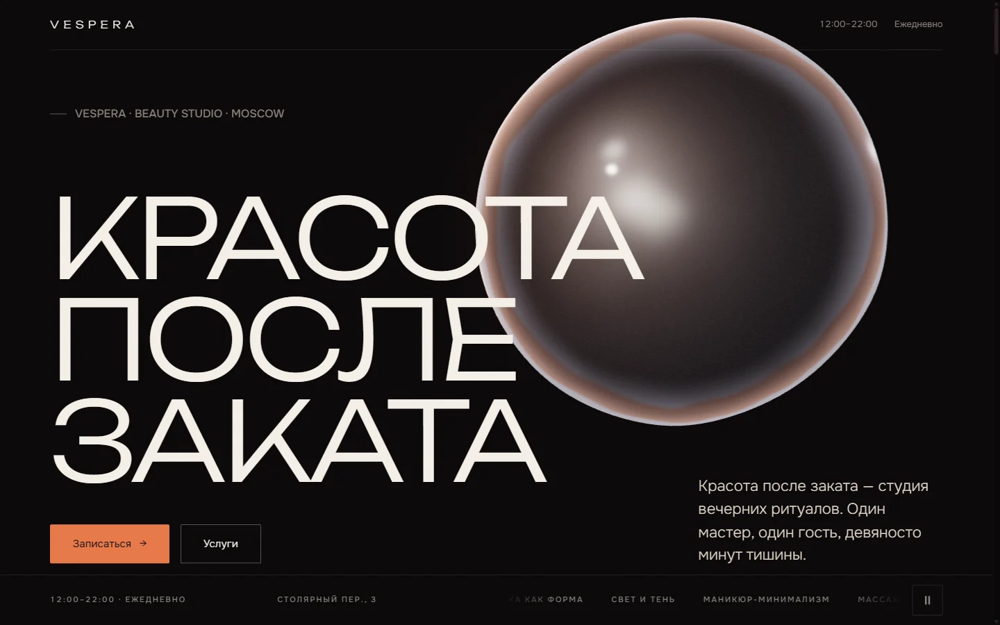

<br />
<br />

# VESPERA

**Красота после заката**

Лендинг бьюти-студии вечерних ритуалов: 3D-жемчужина на WebGL,
запись в четыре шага и админка, из которой студия живёт.

[**Сайт**](https://vespera-lovat.vercel.app) · [Политика](https://vespera-lovat.vercel.app/privacy) · [Дизайн-система](docs/design-system.md) · [Бриф](docs/brief.md)


</div>

---

## 01 — Задача

Студия, в которую приходят не за процедурой, а за тишиной: один мастер, один гость,
одно пространство на девяносто минут. Такой бренд нельзя показать стоковыми улыбками
в спа — он развалится на первом же баннере.

Полный бриф лежит в [`docs/brief.md`](docs/brief.md). Из него выросли правила, которые
держали всю работу:

- тёмная обсидиановая основа, один тёплый янтарный акцент, **не более 7% площади экрана**;
- типографика с кириллицей: `Unbounded` в заголовках, `Onest` в тексте, `Cormorant Garamond` во врезках;
- никаких фиолетовых градиентов, стекломорфизма на каждом блоке, дефолтного shadcn-вида;
- 3D — один объект и только в hero, бюджет 350 KB gzip, ~60 fps на среднем ноутбуке;
- запись работает по-настоящему: цена и слоты считаются на сервере, бронь видна в админке;
- `prefers-reduced-motion` выключает 3D и параллакс, но контент остаётся полным.

<div align="center">
  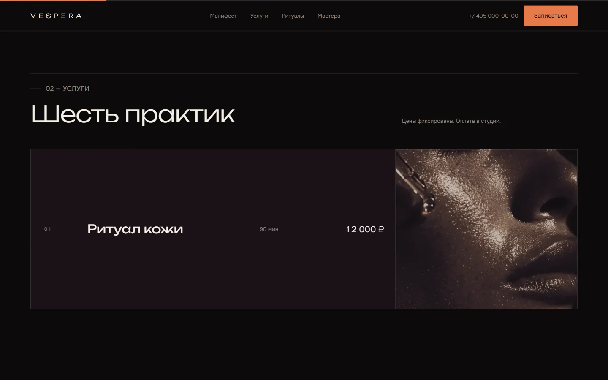
  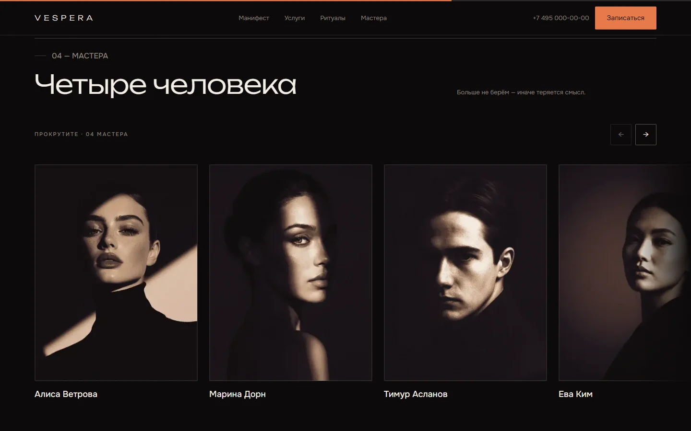
</div>

---

## 02 — Что внутри

<div align="center">
  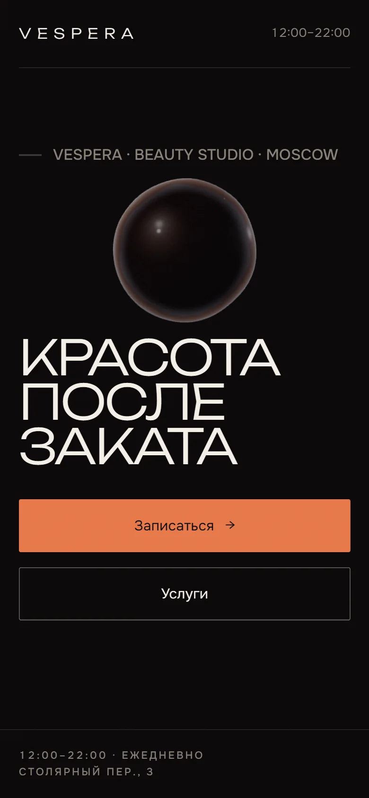
  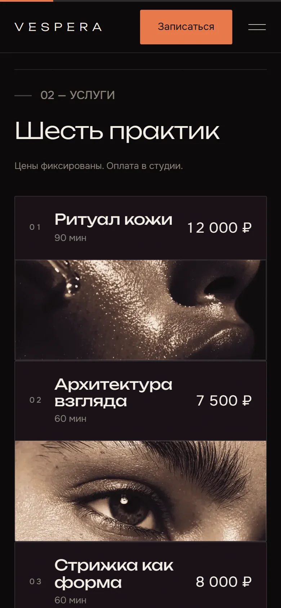
  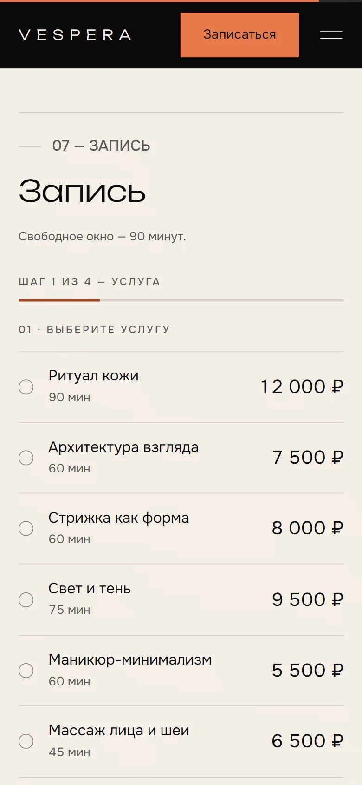
</div>

| Слой | Что сделано |
| --- | --- |
| **Лендинг** | 10 секций: интро, hero, манифест, услуги, ритуалы, мастера, масштаб, отзывы, запись, футер |
| **3D** | Жемчужина на собственном шейдере: иридесценция, свет за курсором, наклон, дыхание, волны от касаний |
| **Запись** | Четыре шага, инлайн-валидация, живые слоты, код брони `VSP-XXXX`, экран подтверждения |
| **Админка** | Календарь месяца и дня, панель брони, каталог услуг и мастеров, администраторы с ролями |
| **Данные** | Neon Postgres на проде, файловое хранилище локально, один интерфейс `StorageDriver` на оба режима |
| **SEO** | `sitemap.xml`, `robots.txt`, OG и Twitter-картинки, JSON-LD `BeautySalon` + `OfferCatalog`, canonical |
| **Служебное** | `/privacy` с человеческим текстом, брендовая 404, `error` и `global-error` без стектрейсов |
| **Доступность** | Клавиатура, видимый фокус, `aria` у слайдеров и формы, Lighthouse Accessibility 100 |

---

## 03 — Запись

Четыре экрана, между которыми сохраняется состояние: услуга → мастер → дата и время → контакты.
Слоты приходят с сервера и учитывают длительность услуги, рабочие дни мастера и уже занятое время.

<div align="center">
  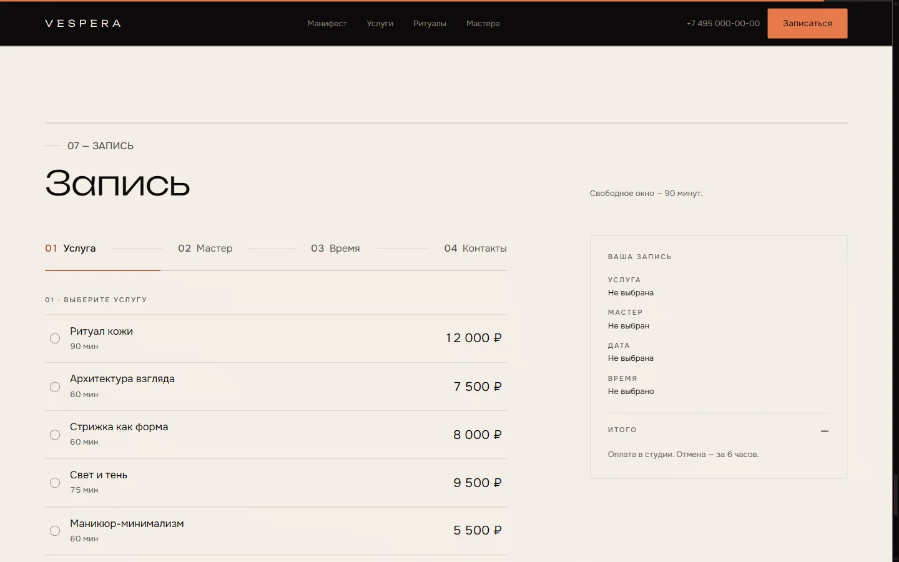
  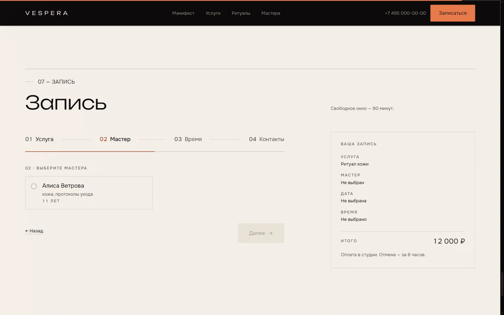
</div>
<div align="center">
  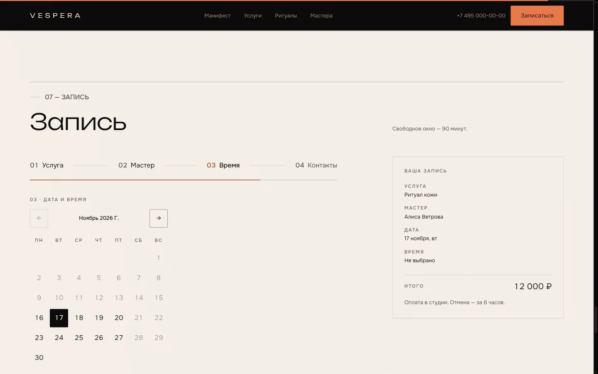
  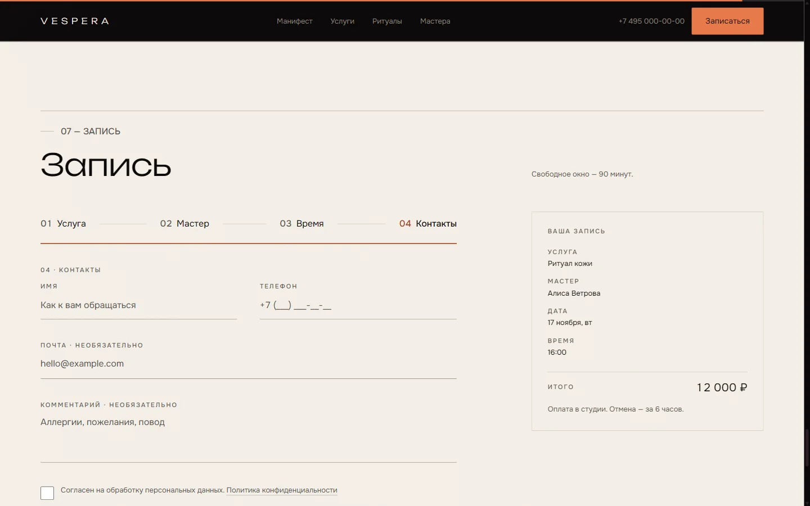
</div>

Цена и длительность **никогда не принимаются от клиента**: сервер берёт услугу из каталога
и пересчитывает всё заново. Если каталог изменили в админке — бронь всё равно посчитается
по актуальным данным.

---

## 04 — Админка

Календарь на месяц, день по часам, панель брони с контактами и комментарием.
Каталог редактируется на месте: новая услуга сразу появляется на лендинге.

<div align="center">
  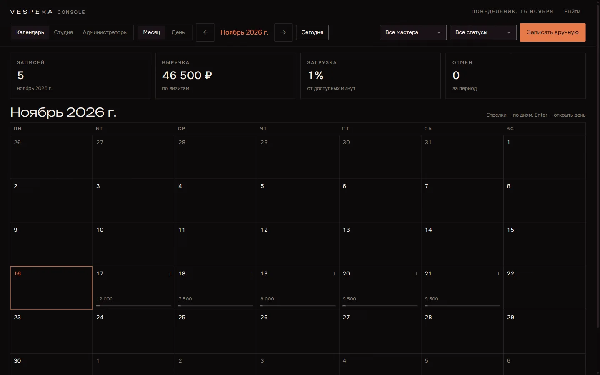
  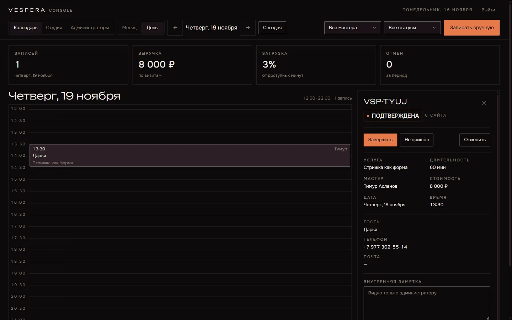
</div>
<div align="center">
  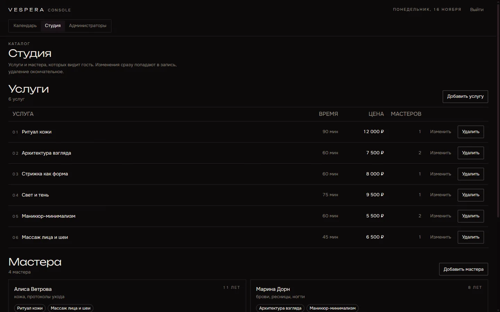
  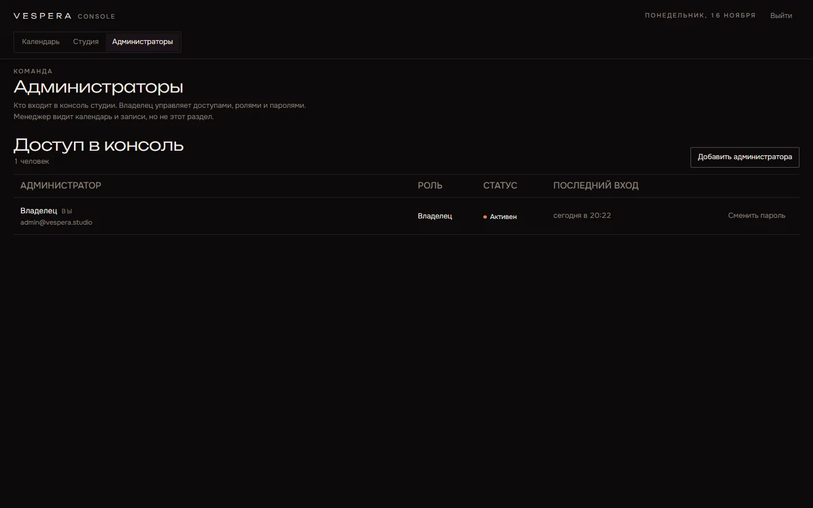
</div>

- **Роли.** `owner` управляет всем, `manager` — только записями и каталогом.
- **Пароли.** `scrypt` (N=16384, r=8, p=1), соль на пользователя, сравнение через `timingSafeEqual`.
- **Сессии.** Подписанная `HttpOnly` cookie, срок жизни ограничен, деактивация отзывает доступ за секунды.
- **Защита.** Rate limit на вход и на заявки, honeypot в форме, `noindex` на всём `/admin`.
- **Удаление вместо архива.** Если студия просит «удалить» — удаляем, но сначала проверяем будущие брони
  и дописываем названия в историю, чтобы старые записи не превратились в `undefined`.

---

## 05 — Жемчужина

Один объект, одна сцена, ни одного внешнего HDR. Иридесценция, тёплый ключевой свет,
холодный заполняющий, плёночное зерно по краю — всё в одном фрагментном шейдере.

Волны от касаний живут в кольцевом буфере из шести слотов: три клика подряд дают три
отдельные дуги, а не одну сплющенную. Каждая волна — гребень с коротким шлейфом
и слабый внешний ореол, вчетверо тише:

```glsl
// behind > 0 — гребень уже прошёл точку: фронт слева, шлейф справа.
float behind = arc - age * 0.82 * (0.85 + 0.3 * seed);
float tail   = 0.1 * (0.8 + 0.4 * seed);

// Гребень: мягкий фронт и быстрое затухание сразу за ним.
float crest = smoothstep(-0.05, 0.01, behind) * exp(-max(0.0, behind) / 0.045);
// Ореол: вчетверо слабее и вдвое длиннее — глубина без «проволоки».
float halo  = smoothstep(-0.09, 0.02, behind) * exp(-max(0.0, behind) / tail) * 0.12;

// Мягкое насыщение: три и шесть волн не складываются в блёклое пятно.
float waveLight = 1.0 - exp(-waveRing * 1.0);
```

Сцена держит бюджет: `dpr` ограничен 1.75, рендер встаёт при уходе из вьюпорта,
при `prefers-reduced-motion` включается статичный градиент вместо WebGL.

---

## 06 — Пять решений, которые стоили больше всего

### 1. Бронь атомарна, а не «надеемся на лучшее»

Документы лежат в `jsonb`, поэтому мутация — это `read → JS → write`. Два гостя
могут выбрать один слот одновременно, и `SELECT ... FOR UPDATE` тут не спасает:
пустую строку он не блокирует. Лок берётся на документ и держится до `COMMIT`:

```ts
await runQuery(client, "BEGIN", [], deadline);
await runQuery(client, "SELECT pg_advisory_xact_lock(hashtext($1))", [name], deadline);

const rows = await runQuery(client, `SELECT data FROM ${TABLE} WHERE name = $1`, [name], deadline);
// ... проверка занятости и вставка — внутри той же транзакции
```

Проверка занятости и вставка происходят в одной критической секции. Проигравший
получает `409 slot_taken`, а не две брони на одно время.

### 2. Холодный старт Neon — это не баг, это режим работы

Compute засыпает, первый коннект обрывается по таймауту. Вместо «попробуйте позже»
драйвер делает до трёх попыток с паузами 250 / 750 / 1500 мс и общим бюджетом 25 секунд.
Транзакция повторяется только после явного `ROLLBACK` — никогда после отправки `COMMIT`,
иначе можно записать бронь дважды. Если не вышло — честный `503` с `Retry-After`.

### 3. «Удалить» значит удалить

Классическая ловушка: услугу удалили, а в истории броней осталось `serviceId: "svc-3"`.
Поэтому перед удалением названия услуг и мастеров дописываются снапшотами в записи,
будущие брони проверяются гардом, а мастер без единой услуги не удаляется вовсе —
он остался бы без работы в прямом смысле.

### 4. Жемчужина телепортировалась при скролле

Симптом: при медленном скролле с самого верха сфера резко уезжала влево. Причина —
масштаб считался от центра полноэкранной обёртки, а не от точки, где стоит сфера:
уменьшение тянуло её к центру контейнера. Лечится одной строкой, но её пришлось
искать замерами `getBoundingClientRect()` на 0 / 25 / 50 / 100 / 200 px:

```tsx
// Масштаб и сдвиг — от позиции самой сферы, а не от центра секции.
"[transform-origin:50%_31.4%] md:[transform-origin:72%_42%] lg:[transform-origin:68%_36%]"
```

После правки X-координата центра не меняется ни на пиксель на всех позициях скролла.

### 5. «До и после» без обмана

Секция сравнения «до/после» требует реальных пар одного человека. Таких кадров не было,
а подделывать — нечестно. Секция переосмыслена: теперь она сравнивает **макро и общий кадр
одного и того же снимка** — «МАКРО ×2,5» против «КАДРА», один свет, без ретуши.
Слайдер остался, смысл стал правдой.

<div align="center">
  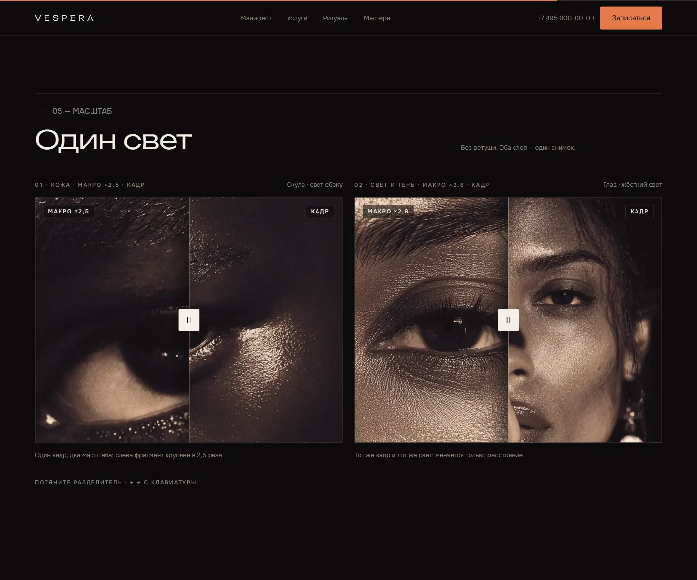
</div>

---

## 07 — Архитектура

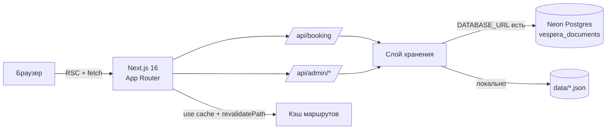

Один интерфейс `StorageDriver` и две реализации: файловая для разработки и Postgres для прода.
Никакой ветки «а на проде иначе» в бизнес-логике нет.

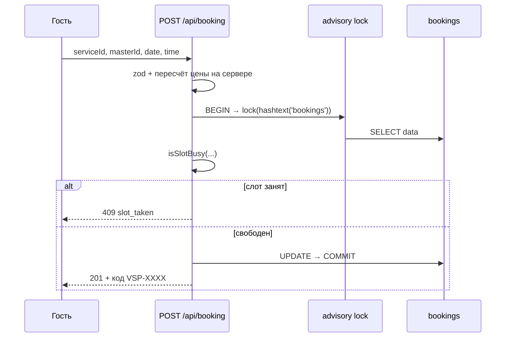

---

## 08 — SEO и доступность

<div align="center">
  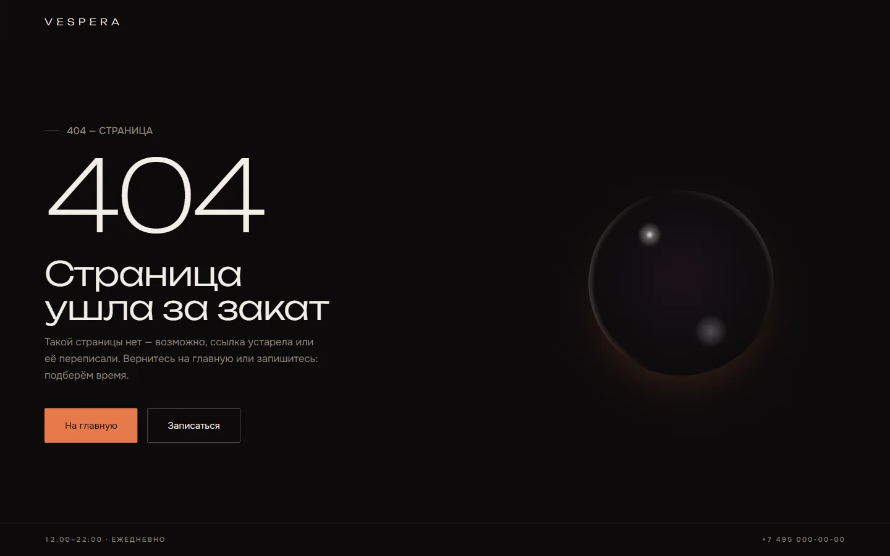
  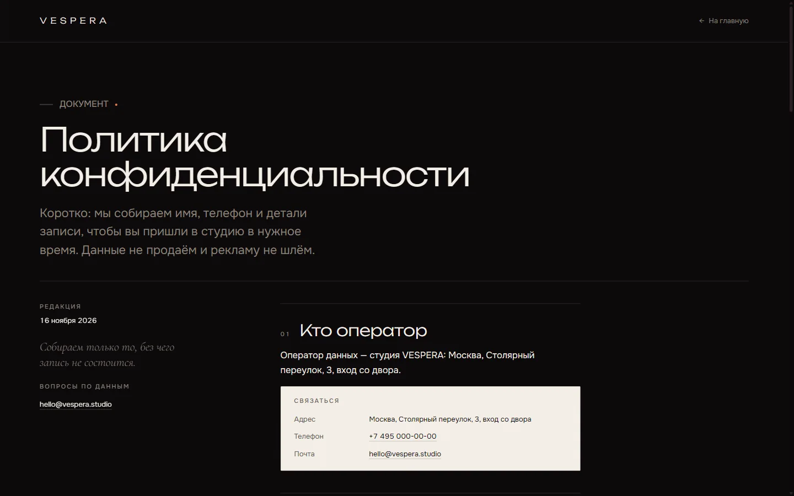
</div>

| Что | Как |
| --- | --- |
| Иконки | `icon.svg`, `apple-icon`, `favicon.ico`, `manifest` |
| Соцсети | `opengraph-image` и `twitter-image`, картинка рисуется кодом, кириллица корректная |
| Индексация | `robots.txt`, `sitemap.xml` с `lastModified` из каталога, `/admin` и `/api` закрыты |
| Разметка | JSON-LD `BeautySalon`, `WebSite`, `OfferCatalog` с реальными услугами и ценами |
| Служебные | `/privacy`, 404 с честным статусом, `error` и `global-error` без стектрейсов |
| Доступность | Слайдеры с `role="slider"` и стрелками, фокус виден, контраст проверен, 3D отключаем |

Политика написана для гостя, а не для разработчика: что собираем, зачем, где лежит, как удалить.
Внутренности (`scrypt`, имена cookie, роли, провайдеры) в тексте отсутствуют намеренно.

---

## 09 — Цифры

| Метрика | Значение |
| --- | --- |
| Lighthouse Accessibility (mobile) | **100** |
| Lighthouse Best Practices | **100** |
| Lighthouse SEO | **100** |
| Cumulative Layout Shift | **0.00** |
| Largest Contentful Paint | **1,5 с** (desktop, холодный кэш) |
| TTFB | **0,27 с** |
| Unit-тесты логики записи | **25** |
| Строк TypeScript в `src/` | **17 000** |

---

## 10 — Запуск

```sh
npm install
cp .env.example .env.local     # заполнить значения
npm run dev                    # http://localhost:3000
```

Без `DATABASE_URL` приложение работает на файлах в `data/` — этого достаточно для разработки.
На проде файловая система только для чтения, поэтому база обязательна.

| Переменная | Зачем |
| --- | --- |
| `DATABASE_URL` | Строка Neon Postgres. Без неё — файловое хранилище |
| `ADMIN_EMAIL` | Почта владельца, создаётся при первом запуске |
| `ADMIN_PASSWORD` | Пароль владельца для bootstrap, дальше только `scrypt`-хеш в базе |
| `ADMIN_SESSION_SECRET` | 64 hex-символа для подписи cookie сессии |
| `NEXT_PUBLIC_SITE_URL` | Canonical, OG, `robots.txt`, `sitemap.xml` |

Проверки: `npx tsc --noEmit`, `npm run lint`, `npm test`, `npm run build`.
Тесты покрывают логику записи — сетку слотов, конфликты, лид-тайм, телефон, коды и rate limit —
без базы и без сервера: модуль `booking.ts` намеренно чистый.

---

## 11 — Структура

```text
vespera/
├── src/
│   ├── app/                  маршруты, API, SEO-файлы, служебные страницы
│   │   ├── admin/            админка: календарь, студия, администраторы
│   │   ├── api/              booking, availability, admin/*
│   │   └── _ui/              общие экраны статусов
│   ├── components/
│   │   ├── site/             секции лендинга и форма записи
│   │   ├── three/            сцена, шейдер жемчужины, управление указателем
│   │   └── admin/            интерфейс админки
│   ├── lib/
│   │   ├── booking.ts        слоты, конфликты, время Europe/Moscow
│   │   ├── studio-store.ts   каталог услуг и мастеров
│   │   └── storage/          StorageDriver: файлы и Postgres
│   └── content/              тексты, услуги, мастера, кейсы
├── docs/                     бриф, дизайн-система, API, деплой
└── public/images/            обработанные WebP: дуотон, кроп по сетке
```

---

## 12 — Честные ограничения

Это проект одной студии, и архитектура честно следует масштабу:

- вся история броней — один JSON-документ, который перезаписывается целиком; для тысяч записей нужна нормализация;
- rate limit живёт в памяти инстанса: на нескольких лямбдах лимит действует на каждую отдельно;
- смена пароля не отзывает уже выданные сессии (деактивация отзывает);
- политика конфиденциальности — шаблон, а не заключение юриста: срок хранения 12 месяцев заявлен, но автоудаления пока нет.

Всё остальное — работает: запись проходит end-to-end, бронь видна в админке,
правка каталога сразу отражается на сайте, данные переживают холодный старт.

---

<div align="center">

<sub>Концепт-проект. Бренд, мастера и цены вымышлены.<br/>
Next.js 16 · React 19 · TypeScript · Tailwind v4 · React Three Fiber · Neon Postgres</sub>

<br />
<br />

**[↑ Наверх](#vespera)**

</div>

<details>
<summary><b>In English</b></summary>

<br />

**VESPERA** is a concept landing page for an evening beauty studio: a WebGL pearl rendered with a
custom shader, a four-step booking flow backed by a real database, and an admin panel the studio
actually runs on.

The interesting parts are the engineering ones: bookings are atomic through a Postgres advisory lock
(serialising the read-check-write on a `jsonb` document), the Neon cold start is handled with bounded
retries and an honest `503 + Retry-After`, catalogue deletion writes name snapshots into booking
history so old records never turn into `undefined`, and a long-standing scroll "teleport" of the 3D
object was tracked down to a wrong `transform-origin` and verified by measuring the object's centre at
five scroll positions.

Read the full brief in [`docs/brief.md`](docs/brief.md) and the design system in
[`docs/design-system.md`](docs/design-system.md).

</details>
